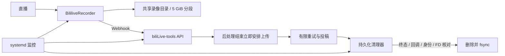

# 录播与自动投稿流水线

A reproducible recording and upload integration for BililiveRecorder and biliLive-tools.

本项目将 **BililiveRecorder 2.18.0** 与 **biliLive-tools 3.20.0** 组合为可部署的录播、自动投稿、持久化清理和监控方案。它是集成脚本与小范围补丁项目，与两个上游独立，不是其官方发行版，也不替代上游账号登录和投稿管理。

保留已验证的版本及镜像 digest，不自动追随最新上游。新部署默认 **成功后删除，最终失败保留**；可显式启用最终失败后删除。永久删除无法通过回滚恢复，且不等待 B 站审核。



录制和上传并行，分段不等待上一文件上传完成。保留原生周期扫描、分 P 和稿件合并；按直播串行调度，分别保留 handled/raw 请求。读取流在每次上传尝试的 finally 中关闭，包括失败、取消和限速路径。

清理台账使用 SQLite WAL/FULL，记录源路径、设备/inode/大小/纳秒时间、父子任务、关闭分段、删除意图及结果。活动、暂停、排队、有效重试、未结束回调、打开 FD、身份变化或关联不明均保留；API/FD 扫描不完整停止删除。不会因任务从 API 消失或录像过旧就认定失败，也不自动重新投稿。

新部署请从 [部署文档](docs/deployment.md) 开始：

```sh
git clone https://github.com/sceneeeee/bililive-record-upload-pipeline.git
cd bililive-record-upload-pipeline
bash scripts/extract_upstream.sh
bash tests/run.sh
```

需要 Linux/amd64、Docker Compose、systemd、Python 3.10+、Node.js 22、GNU patch 和 Bash。已有原始 bundle 可离线构建：

```sh
python3 scripts/build_patches.py --upstream /path/to/upstream
python3 scripts/verify_release.py
```

提供 [空凭据示例](compose/.env.example)、[录播姬配置示例](examples/recorder/config.example.json)、固定 digest 的基础/修补 Compose，以及安装、升级准备、安全窗口和回滚工具。所有操作在用户自己的目标主机执行，无须任何预设 SSH 别名。默认业务路径 `/opt/bililive-stack` 可通过 `STACK_ROOT` 调整；systemd 安装器据此生成路径。

- [架构与删除边界](docs/architecture.md)
- [安装、房间、投稿与删除配置](docs/deployment.md)
- [运维与清理验证](docs/operations.md)
- [更新、发布与回滚](docs/rollback.md)
- [测试与尚未验证的功能](docs/validation.md)
- [补丁与 SHA256](patches/README.md)

已覆盖 Python 单元测试、实际 bundle 方法的 Node.js 模拟、错误上游拒绝、部署准备保护。**尚未完成本公开版本真实直播的端到端验证**：自然开播、5 GiB 分段持续增长、立即上传、终态清理、分 P 顺序和合并仍需在独立环境及后续自然直播观察。测试通过不代表网络故障或同秒文件名冲突已消除。未知录像、小文件、封面和旁车继续保留。

本仓库新增代码采用 **GPL-3.0-only**，见 [LICENSE](LICENSE)；上游代码及依赖保留各自声明，见 [THIRD_PARTY_NOTICES.md](THIRD_PARTY_NOTICES.md)。凭据和运行数据不得入库，漏洞报告见 [SECURITY.md](SECURITY.md)，贡献约定见 [CONTRIBUTING.md](CONTRIBUTING.md)。
