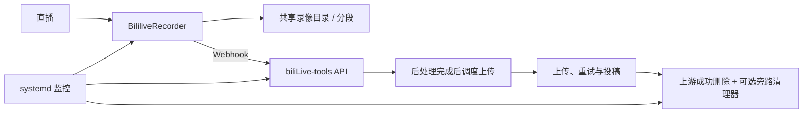

# 录播与自动投稿流水线

[](https://github.com/sceneeeee/bililive-record-upload-pipeline/actions/workflows/ci.yml)
[](LICENSE)

**面向自托管环境的 Bilibili 直播录制与自动投稿集成方案**。本项目将 [BililiveRecorder](https://github.com/BililiveRecorder/BililiveRecorder) 与 [biliLive-tools](https://github.com/renmu123/biliLive-tools) 组合，并通过小范围、可复现的补丁和独立维护工具补足特定工作流。

> 本项目是独立的社区集成，不是 BililiveRecorder 或 biliLive-tools 的官方发行版。请先阅读[验证范围](docs/validation.md)和[生产证据说明](docs/production-evidence.md)：历史生产部署确实运行过相关录播/投稿链路，但其调度补丁和清理实现与当前公开版本存在差异，不能把历史运行记录等同于当前公开提交的完整生产验收。

## 项目概览

当前公开版本锁定：

| 组件 | 版本 | 用途 |
| --- | --- | --- |
| BililiveRecorder | 2.18.0 | 直播录制、分段和 Webhook |
| biliLive-tools | 3.20.0 | 后处理、上传、投稿、分 P / 合并 |

镜像 digest、上游 bundle 原始 SHA256 和补丁输出 SHA256 记录在 [版本锁](patches/versions.lock.json)。构建脚本只接受锁定输入，不自动追随上游最新版；完整上游 bundle 不提交到本仓库。

## 工作流



录制与上传可以并行，分段不需要等待上一文件上传结束。上传主体、重试、分 P 和稿件合并仍以锁定的上游实现为基础；本仓库只对明确列出的行为做最小补丁。

## 主要能力

- **可复现上游构建**：锁定 Linux/amd64 镜像 digest、bundle 输入/输出 SHA256，并使用零 fuzz 补丁。
- **上传流生命周期修补**：在上传尝试结束时关闭源文件流和限速流，并将文件身份信息带入任务元数据。
- **即时上传调度补丁**：后处理完成后异步安排上传，同时保留周期扫描作为补充；同一直播的调度串行化，并分别保留 handled、raw 和未指定类型的待办请求。
- **保守的持久化清理器**：使用独立 SQLite 台账，结合上传父子任务、回调、文件身份、打开 FD 和 API 快照判断删除资格。
- **运维工具**：提供 Compose 示例、systemd unit、监控、部署准备、安全窗口和回滚工具。
- **离线验证**：Python / Node.js 测试、锁定构建校验、Compose / systemd 校验和敏感信息扫描。

## 数据安全与删除语义

删除录像不可逆，不能通过 Git 回滚、数据库台账或重新部署恢复。

- 公开旁路清理器默认只允许已确认的成功终态；最终失败默认保留，只有显式启用 `--delete-final-failure` 才允许失败终态进入删除资格判断。
- 手动取消、活动/排队/重试任务、未结束回调、打开 FD、身份变化、API/FD 扫描不完整或关联不明时，应保留文件。
- 上游 `afterUploadDeletAction=delete` 的原生成功删除仍然存在；旁路清理器无法追溯保护上游已经执行的删除。
- 上传成功不代表 Bilibili 审核通过或远端永久可用。请按自己的备份和重传需求设置上游删除策略。
- **历史生产部署曾允许删除最终失败录像**，而当前公开版本默认失败保留。两者不是同一删除策略；迁移时必须单独核对，不能直接套用历史生产配置。

## 快速开始

以下步骤在自己的 Linux/amd64 目标环境执行。完整前置条件、凭据配置、Webhook、房间设置和维护窗口请先阅读[部署指南](docs/deployment.md)。

```sh
git clone https://github.com/sceneeeee/bililive-record-upload-pipeline.git
cd bililive-record-upload-pipeline

# 从锁定镜像提取上游 bundle、应用补丁并校验 SHA256
bash scripts/extract_upstream.sh

# 运行 Python 与 Node.js 测试
bash tests/run.sh
```

也可使用已有的上游 bundle 离线构建：

```sh
python3 scripts/build_patches.py --upstream /path/to/upstream
python3 scripts/verify_release.py
```

需要 Linux/amd64、Docker Compose、systemd、Python 3.10+、Node.js 22、GNU patch 和 Bash。生成的完整 bundle 位于被 Git 忽略的 `build/`，不应提交或作为本项目 Release 附件重新分发。

## 文档导航

| 文档 | 内容 |
| --- | --- |
| [部署指南](docs/deployment.md) | 安装、录播房间、投稿配置、维护窗口 |
| [架构与状态边界](docs/architecture.md) | 调度、上传流、清理状态和删除边界 |
| [运维指南](docs/operations.md) | 只读检查、监控、清理验证和故障定位 |
| [验证范围](docs/validation.md) | 测试覆盖、证据等级和已知限制 |
| [生产证据说明](docs/production-evidence.md) | 历史生产基线与公开版本的对应关系 |
| [更新与回滚](docs/rollback.md) | 版本升级、维护窗口和回滚 |
| [补丁说明](patches/README.md) | 补丁目的、构建方式和哈希锁 |
| [变更记录](CHANGELOG.md) | 面向用户的变更历史 |
| [贡献指南](CONTRIBUTING.md) | 开发和提交约定 |
| [安全政策](SECURITY.md) | 漏洞报告和敏感信息处理 |
| [第三方声明](THIRD_PARTY_NOTICES.md) | 上游版权与依赖许可证 |

## 验证状态与发布阶段

本仓库当前以 **预发布候选** 的标准描述，不宣称当前公开提交已完成生产端到端验收。

| 项目 | 当前证据 | 限制 |
| --- | --- | --- |
| 上游镜像与 bundle 锁定 | CI 构建及 SHA256 校验 | 仅对锁定版本有效 |
| 上传流关闭补丁 | 公开测试通过；历史生产运行 bundle 哈希匹配 | 不能据此证明所有生产异常路径均已验证 |
| handled/raw 调度待办保留 | 公开 Node.js 回归测试通过 | 历史生产调度 bundle 是旧基线，未包含此修复 |
| 约 5 GiB FLV 分段、Webhook 和上传链路 | 历史生产台账与日志有观察证据 | 历史实例不是当前公开调度实现 |
| 同稿件多次投稿/编辑 | 历史生产台账有聚合证据 | 不等同于公开播放页分 P 顺序和完整性验证 |
| 失败默认保留及公开清理保护 | Python 合成测试覆盖 | 公开清理器未在历史生产环境部署 |
| 安装、维护窗口和回滚 | 脚本与 CI/离线校验 | 未完成当前公开版本的真实新主机演练 |

详细说明见[验证范围](docs/validation.md)。不要将离线测试、历史祖先版本的运行记录或容器存活状态解释为当前公开版本的完整生产认证。

## 安全与许可

新增集成代码采用 **GPL-3.0-only**，见 [LICENSE](LICENSE)。BililiveRecorder、biliLive-tools 及其依赖保留各自版权与许可证，见 [第三方声明](THIRD_PARTY_NOTICES.md)。

不要提交真实 `.env`、Cookie、SESSDATA、Token、密码、录像、数据库/WAL、台账、备份、原始日志或 `temp_report.md`。安全问题请遵循 [SECURITY.md](SECURITY.md)，不要在公开 Issue 上传可利用凭据或生产数据。

---

**English overview:** [docs/README.en.md](docs/README.en.md)  
**Releases:** [GitHub Releases](https://github.com/sceneeeee/bililive-record-upload-pipeline/releases)
